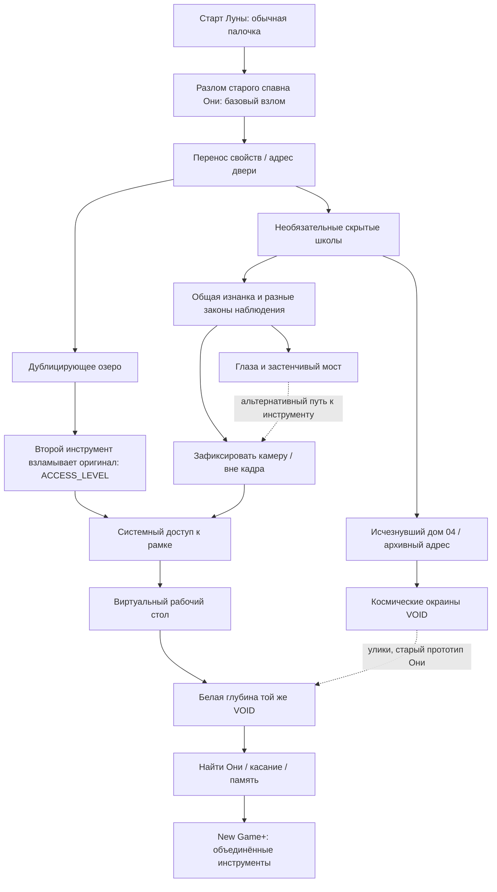

# 14 — Граф знаний, скрытые школы и множественные пути к метафиналу

> V3, 09.11.2026. Это главный рабочий документ пазл-бокса. **Игрок должен получить новый закон мира, а не набор произвольных паролей.** Все предложенные локации и способы тестирования — ПРОЕКТ, пока не проверены маленькой играбельной сценой.

## 1. Как читать граф
Каждый узел имеет наблюдение → закон → эксперимент → новую возможность. Стрелка «помогает» означает обучающий путь, а **не проверяемый флаг**. Игрок может применить закон до прочтения подсказки, если физически способен выполнить действие.

**Критично:** стрелка из космической VOID в белую обозначает **улики или редкий секретный переход, ещё не утверждённый**, а не обязательный быстрый телепорт. В белую глубину нельзя попасть случайно одним неверным адресом без осмысленного открытия.

## 2. Учебная зона всегда даёт физическое доказательство
Существование секретных зон — **КАНОН**. Их точное количество — ПРОЕКТ. Учебная зона должна работать как небольшая головоломка и быть скрыта в самой географии. Никакой длинной дидактической объяснялки или маркера «обучение системе №4».

| Рабочий код | Где вход | Что игрок видит | Какой закон выводит | Где потом использует |
|---|---|---|---|---|
| `HIDDEN-01` Невидимая кладка | За обычным невидимым мостом в овраге | Яблоки и дождь падают на пустую платформу, уцелевший мостик | Видимость ≠ коллизия | Короткий путь к башне, секретные подземелья |
| `HIDDEN-02` Комната без глаз | За стеной с испуганными зверушками | Платформа возникает при закрытых глазах, тон меняет высоту по мере проявления | Прямой взгляд меняет состояние некоторых объектов | Застенчивые мосты, антимеметическое существо |
| `HIDDEN-03` Брошенное отражение | В архивном доме/за зеркалом | Изображение и реальный объект ведут себя по-разному | Представление не тождественно физической сущности | Секретный HUD, рамка |
| `HIDDEN-04` Схема недостающей двери | Между домами 03 и 05 | Механизм с двумя реальными дверями, но адрес «четвёртой» | Доступное назначение двери можно перенаправить | `ELF_HOUSE_04`, [VOID] |
| `HIDDEN-05` Кадр без героя | На краю знакомой поляны/в нише позади водопада | Камера замерла; предмет исчез за кадром, но его шаги слышны; другое состояние у моста | Граница кадра участвует в законе наблюдения | Мост вне камеры, оконная рамка |
| `HIDDEN-06` Старая сборка | В космической VOID | Незаконченная Они на точке старого разлома | Удалённые данные и начало взлома Луны связаны | Расследование происхождения, белая Пустота |
| `HIDDEN-07` Осколки истории | В глубокой VOID | Повторяющаяся сцена без одного NPC, разрушенная анимация/обрывок памяти | Отсутствие оставляет физические ссылки | Эмоциональное понимание Они |

Секрет может иметь ещё и «обычную» дорожку обучения в сюжетной кампании. Знающий игрок имеет прямой подход к уже существующей комнате, если нашёл физический вход.

## 3. Три независимые улики для каждого крупного закона
### A. Физически существующий невидимый мост
- **Улика 1:** птица садится в воздухе.
- **Улика 2:** яблоко/камешек отскакивает от невидимой поверхности.
- **Улика 3:** дождь разбивается о пустоту (можно ждать погоды).
- **Опыт:** бросить второй предмет, осторожно пройти при безопасном падении.
- **Ретроспектива:** Юки показывает, что мост включён в целую систему скрытых проходов.

### B. Глаз и внимание
- **Улика 1:** невидимое существо/предмет двигается, когда герой отвернулся.
- **Улика 2:** Тоффи замечает, что гигант отвечает на длительный взгляд.
- **Улика 3:** в секретной комнате платформа звучит и проявляется только при закрытых глазах.
- **Опыт:** сравнить короткое моргание и длительное закрытие (сигнал по звуку), не требовать угадывать ровно 7 секунд.
- **Ретроспектива:** можно безопасно пройти мимо антимеметического гиганта за Луну даже без зрения Тоффи.

### C. Палочку может взломать другая палочка
- **Улика 1:** озеро дублирует простой физический предмет.
- **Улика 2:** палочка показывает часть собственных недоступных полей.
- **Улика 3:** в скрытой мастерской есть запись/физический пример, что инструмент не может изменять самого себя, зато другой того же типа может.
- **Опыт:** выбросить палочку из инвентаря в озеро, использовать дубликат на лежащем оригинале.
- **Ретроспектива:** игрок узнаёт, что границы инструментов были ограничением конструктора, а не магической невозможностью.

### D. Камера и мост вне кадра
- **Улика 1:** фиксированная камера перестаёт сопровождать Луной управляемый объект, но движение продолжается.
- **Улика 2:** предмет за краем кадра издаёт шаги/меняет состояние, хотя физически находится в пределах карты.
- **Улика 3:** секретная зона демонстрирует мост, который не держит персонажа, пока виден в кадре, и становится твёрдым только вне наблюдения камеры.
- **Опыт:** зафиксировать камеру, увести Луну к мосту за кадром, получить безопасный звук попадания на устойчивую поверхность.
- **Ретроспектива:** экран перестаёт ощущаться абсолютной границей мира; возникает вопрос об окне.

### E. Рамка
- **Улика 1:** ряд особых физических представлений, которые допускают взлом, в том числе портрет и мини-карта.
- **Улика 2:** найденный рисунок/набросок рамки поверх игрового пейзажа; подпись без буквального «переключитесь в оконный режим».
- **Улика 3:** персонаж, который дошёл до особой границы кадра, слышит узнаваемый отказ слабой палочки и способен увидеть контур рамки при изменении режима окна.
- **Опыт:** достигнуть цели, поднять `ACCESS_LEVEL`, выбрать рамку и применить обычный взлом.
- **Ретроспектива:** чужой наблюдатель существовал с самого старта, включая забавное `ch_<имя игрока>`.

### F. Удалённый персонаж
- **Улика 1:** обрывки имени седьмого члена команды в диалогах и необычное пустое место в сцене.
- **Улика 2:** ранний прототип с другим героем, физически совпадающий с местом трещины.
- **Улика 3:** остаточные `CHARACTER`-записи и повреждённые связи в [VOID].
- **Опыт:** понять, что история удаления объекта и история удаления персонажа следуют смежным правилам, восстановить конкретную реальную связь с Они.
- **Ретроспектива:** на привычной поляне взлом изначально был следствием её отсутствия.

## 4. Альтернативные пути к одному глубинному финалу
**Путь исследователя Луны:** обычная физика моста → озеро → повышение доступа → скрытая школа камеры → рамка → белая Пустота → Они.

**Путь через Юки:** Юки/её артефакты показывают маршруты и инструментальные свойства раньше, игрок использует знание адресов и камеры, не обязан проходить личную историю. Консоль — удобство, **не кнопка телепорта в финал**.

**Путь через Тоффи/артефакты:** невидимый гигант, закрывание глаз, застенчивые мосты, редкий предмет для обзора, обходная ниша с фиксатором камеры → тот же закон рамки. Тоффи не должен быть обязательным управляемым героем.

**Путь спидраннера:** разлом, озеро, известный физический маршрут к камерному инструменту, верная технология зафиксировать взгляд, усиленная палочка, рамка. При идеальном знании возможен очень ранний финиш, если действия физически выполнены.

**Не утверждённый потенциальный ультра-секрет:** переход из космической [VOID] в глубину белого шума через комбинацию адреса, времени и наблюдения. Он не должен обесценивать обнаружение рамки и момент первого осознания игрока: если будет утверждён, нужно отдельно решить его сцену и условия.

## 5. Математика «доступно всегда» без дешёвого финала
Избегаем двух крайностей:
- Дверь открывается только при `chapter_7_done=true` — плохой прогресс «по флагу».
- Игрок вводит один строковый код в меню и мгновенно получает финал — плохой секрет «по паролю».

Вместо этого — небольшое число **материальных необходимых условий**: рабочая палочка, достаточные права, стабильный физический способ выйти за поле наблюдения и реальная рамка. Знающий игрок исполняет их быстро; новичок учится в тайных лабораториях и через опыт.

Когда предмет позволяет миновать условие, он должен реализовывать **тот же игровой закон** другим способом (например, зеркало вместо отдельного камерного якоря).

## 6. Надёжность и документация уроков
Каждая скрытая школа имеет SAFE_ANCHOR, быстрый повтор опыта, один собственный секрет/награду и минимум одну ссылку на более глубокую загадку. В журнале можно записывать реальные наблюдения, но **не список «9/9 скрытых механик»**. Совмещать смешное и жуткое: учить наблюдательности на опасном гиганте можно в спокойной мини-комнате с дружелюбной мелкой зверушкой.

Перед строительством нового секретного уровня отвечать: какой новый закон изучен, где игрок применит его второй раз, как он обнаружит урок без гида, можно ли воспользоваться им за Луну и что технически надо реализовать?
