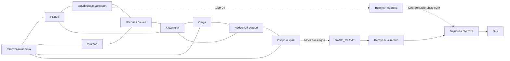

# LUNA: DEV MODE — V3. Подробная карта комнат, переходов, секретов и уровней доступа

> **Черновой layout lock 10.11.2026:** предложения по точным адресам и связям, а не готовые 2D-карты. Физические зоны строить только после готовых ассетов, но **все существующие адреса, типы входов и законы должны быть определены заранее**. Единственный основной открытый мир — Этерния. WORLD 00 — тестовый/разработческий уровень; лаборатория отдельно; Пустота — единый архив сломанных пространств. География не зависит от активного героя и от завершённых квестов.

## 1. Уровень, зона, интерьер, тайник, системная область

- **World** = крупная симуляционная область с общими правилами; `ETERNIA`, `VOID`, `WORLD_00`, `LAB_SANDBOX`, `GAME_SHELL`.
- **Zone** = соседство наружных сцен/экранов и крупный биом: лес, рынок, деревня, ущелье, башня, Академия, сад, остров, озеро.
- **Level** = физически ограниченная сцена с тайлами, коллизиями и объектами; её можно выгружать/подгружать, но Entity IDs продолжают существовать в WorldTruth.
- **Room** = интерьер с дверью: лавка, чердак, кафе, эльфийский дом, лаборатория; может иметь отдельную сцену, но сохраняет связи с зоной.
- **Pocket** = карманное пространство, где геометрия не соответствует внешнему фасаду, но есть настоящие вход/выход и физика.
- **System** = игровая граница, интерфейсная сцена, Пустота и виртуальный стол. Никогда не обращаться к настоящей ОС.

Для каждого `location_id` обязательны `world_id`, `zone_id`, `entry_anchor`, `return_anchor`, `access_tier_for_retarget`, `collision_policy`, `observer_policy`, `persistent_entities`, `legacy_aliases`. `Access` требуется на **перепрограммирование двери** к адресу, а обычный проход в уже настроенную дверь может быть открыт всем при физических условиях.

## 2. Девять основных районов и все сюжетные комнаты

| Район | Реальные сцены (рабочие location IDs) | Видимые выходы | Скрытые входы/особые типы |
|---|---|---|---|
| **A. Стартовая поляна** | `ET_FOREST_START`, `ET_RIFT_STONE`, `ET_KIKI_GROVE`, `ET_FOREST_CREEK` | Рынок B, ущелье D, сад G | Структурная память прототипа; след невидимого великана |
| **B. Рынок и жилой город** | `ET_MARKET_SQUARE`, `ET_FRIDGE_SHOP`, `ET_MARKET_STORAGE`, `ET_CAFE`, `ET_MARKET_HOMES` | A, деревня C, Академия F | Кафе с пустым стулом, старый адрес портрета |
| **C. Эльфийская деревня** | `ET_ELF_SQUARE`, `ELF_HOUSE_01`, `ELF_HOUSE_02`, `ELF_HOUSE_03`, **`ELF_HOUSE_04`**, `ELF_HOUSE_05`, `ELF_HOUSE_06`, `ELF_HOUSE_07`, `ET_ELF_ARCHIVE` | B, E | Дом 04 отсутствует визуально, но зарегистрирован с начала; дверь наружу из него ведёт к `VOID_UPPER` |
| **D. Ущелье, скалы и мосты** | `ET_GORGE_EDGE`, `ET_GORGE_PLAINS`, `ET_SHY_BRIDGE`, `ET_GORGE_CAVE` | A, E, остров H через скрытую сеть | Мост I: всегда физически твёрд; мост II: зависит от прямого взгляда героя; мост III находится в другой зоне I |
| **E. Башня и обсерватория** | `ET_CLOCK_BASE`, `ET_CLOCK_MECHANISM`, `ET_CLOCK_ATTIC`, `ET_OBSERVATORY` | D, C, F | Зеркало, старые отражения и технический наблюдательный механизм |
| **F. Академия и лаборатории** | `ET_ACADEMY_YARD`, `ET_YUKI_CLASS`, `ET_ORI_WORKSHOP`, `ET_MIYA_LAB`, `ET_ACADEMY_ROOF` | B, E, G, H | Четвёртая связь Юки, ремонтные комнаты, ограниченный `ET_SYSTEM_GATE` |
| **G. Сады и скрытая экосистема** | `ET_GARDEN_MAIN`, `ET_LEA_GREENHOUSE`, `ET_TOFFI_BURROW`, `ET_HIDDEN_TRAIL`, `ET_SHY_NEST` | A, F, H | Скрытая фауна, прямой взгляд, некорректные тени |
| **H. Небесный остров** | `ET_SKY_PIER`, `ET_SKY_VILLAGE`, `ET_SKY_UNDERSIDE`, `ET_SKY_OBSERVATION` | G, F, D через сеть, I по скрытому спуску | Физический скат-носитель, частично невидимые опоры, а не отдельная механика антигравитации |
| **I. Озеро и граница** | `ET_LAKE_SHORE`, `ET_DUPLICATION_GROTTO`, `ET_EDGE_SHORE`, `ET_OUT_OF_FRAME_BRIDGE` | H, A, технический выход к `GAME_FRAME` | Озеро Дубликатов; мост III действует только вне поля камеры; системная рамка |

**Разделение секретов:** дом 04 — адресный; верхняя Пустота — пространственный; Озеро — предметный; мост III — наблюдательный; рамка — системный. Это пять разных дедуктивных механизмов, их не следует сводить к пяти закрытым дверям.

## 3. Верхняя и глубокая Пустота

| Адрес | Класс | Можно получить физический доступ | Событие | Право на перенастройку двери |
|---|---|---|---|---|
| `VOID_UPPER` | Архив обломков, тёмная космическая изнанка | Да, через существующий разломный выход `ELF_HOUSE_04`; знающий игрок может найти другую подходящую дверь | Исследование старых комнат, безопасный возврат | **предложение:** ADMIN (2) для произвольной внешней двери |
| `VOID_LOST_ARCHIVE` | Комната забытых ссылок внутри верхней Пустоты | Да, пешком/по адресу, с физическим переходом | Следы прежних записей прототипа | **предложение:** OPERATOR (1) |
| `VOID_DEEP` | Белый шум, низшая глубина той же Пустоты | Через виртуальный стол после `STEP_OUT`; допустим подлинный системный короткий путь | Финальное исследование | **предложение:** DEVELOPER (3) при прямом retarget |
| `VOID_SILENCE` | Спокойная комната Они внутри `VOID_DEEP` | Да, по настоящему пути и точной ссылке | Встреча касанием, возврат памяти | **предложение:** DEVELOPER (3) при прямом retarget |
| `GAME_FRAME` | Системная граница | Мост III/технический подступ | Метавзлом | **предложение:** DEVELOPER (3) для редактирования |
| `VIRTUAL_DESKTOP` | Внутриигровая постановочная «внешняя» оболочка | `STEP_OUT` | Луна обнаруживает игрока | Не обычная дверь; ввод через системное действие |

**Лаборатория `LAB_SANDBOX`** открывается по отдельному безопасному адресу; она никогда не становится обязательным четвертым сюжетным миром. **`WORLD_00`** остаётся прототипным пространством разработчика и не должен внезапно превращаться в основной World A. Метаданные и точный выход будут окончательно заданы при миграции канона.

## 4. Граф переходов, если нет никаких сюжетных флагов

Неведомый игрок обычно замечает A→B→D→F и потом знакомится с героями. Знающий может сразу пойти A→I к Озеру или A→B→C к четвёртому дому. Смена героя и просмотр катсцен не создают/не уничтожают эти рёбра.

## 5. Где находятся обучающие загадки и чем они физически питаются

| Урок | Локация | Минимальные физические объекты | Необязательный герой/взгляд |
|---|---|---|---|
| `U_00` | A | Кики, травы, отпечаток, большой скрытый маршрут | Тоффи |
| `U_01` | A | разлом, живая ветка, ящик, Глаз Оракула | Луна |
| `U_02` | B | холодильник, хозяин, дверь склада, свободный маршрут | Ори |
| `U_03` | B | чашка, еда, NPC-гость, эффект и порции | Мия/Лея |
| `U_04` | D | настоящая невидимая коллизия, дождь, яблоко, птица | Юки |
| `U_05` | F | три двери, указатели, четвёртая связь, журнал | Юки |
| `U_06` | I | дублирующее озеро, два ID палочек, физический владeлец | Луна |
| `U_07` | F | Рин, модуль тела, старый портрет, физический collider | Ори |
| `U_08` | F | ёмкость, трубопровод, остаточный эффект, уменьшенный блок | Мия |
| `U_09` | G | отношения, настроение, последователи, узкая дверь | Лея |
| `U_10` | G/A | реально движущийся невидимый гигант, трава, куст | Тоффи |
| `U_11` | G | реактивное существо, коллизии, слуховые улики | Тоффи |
| `U_12` | D | `DIRECT_GAZE`, таймер/звук проявления, мягкое возвращение | Тоффи/Юки |
| `U_13` | E | глобальное время, механизм, отражение старого здания | Мия/Ори |
| `U_14` | E | Зеркало, камера, герой, удалённая Entity | Ори |
| `U_15` | C | валидная дверь, номер 04, исчезнувший интерьер | Юки/Лея |
| `U_16` | C/F | защищённый адрес, палочка низшего/высшего уровня | Луна/Юки |
| `U_17` | I | камера как отдельный observer, мост III, безопасный край | Собственная дедукция игрока |
| `U_18` | GAME_FRAME | системная Entity, high-access палочка, переход STEP_OUT | Собственная дедукция игрока |
| `U_19` | VOID_DEEP | следы, старый spawn, неполная модель, память | Лея/Мия/Юки дают основания |
| `U_20` | VOID_SILENCE | Они, касание, сохранение Entity identity, катсцена | Они объединяет всё |

## 6. Последовательность загрузки 2D-комнат (контракт будущего WorldManager)

1. **Preflight**: физический глагол `OPEN/STEP_OUT` и валидный `TARGET_LOCATION`; проверка права именно на retarget, если игрок *переписал* дверь.
2. **Commit destination**: проверить реестр адреса и существование входного якоря. Несуществующий адрес должен вернуться без уничтожения позиции.
3. **Checkpoint**: сохранить состояниe исходной зоны, NPC и временных эффектов, но без привязки идентичности к выгруженной ноде.
4. **Transition**: загрузить временную graybox-площадку или подготовленные 2D тайлы/спрайты позднее; реестр ID сохраняется.
5. **Arrival**: поставить игрока на явный безопасный anchor; камера возвращается из секретного режима если переход не предусматривает обратного.
6. **Reconcile**: вернуть NPC/предметы по существующим ID, восстановить уличные события без повторного спавна дублей.
7. **Return**: сохранять anchor исходного входа, предотвращать застревание в комнате без двери; `LAB_SANDBOX` всегда имеет резервный возврат.
8. **Network/OS**: никакого открытия внешних файлов, обращений к настоящему рабочему столу или управления ОС. Вся «операционная система» — нарисованная сцена игры.

## 7. Границы, которые пока нельзя забывать

**Секрет не должен превращаться в «контент только по сюжету».** Дом 04, физические мосты, зеркальные следы, Озеро и Пустота имеют регистрацию с первого запуска. Можно скрывать видимость и требовать реальный инструмент, но не создавать секрет только после завершения 6 побочек.

**Специальный доступ — это свойство физического инструмента.** Если обычный герой нашёл уже настроенный системный проход, он может туда войти, не становясь разработчиком. Игроку требуется уровень ADMIN/DEVELOPER, чтобы **переписать** произвольную дверь к соответствующему адресу или редактировать `GAME_FRAME`. Точные классы доступа выше — предложения и должны быть подтверждены.

**Точная геометрия ещё не создана.** Это карта связей и контракты для механики. Даже открытость графа нельзя считать проверенной, пока не появится пустой 2D graybox всех переходов.
