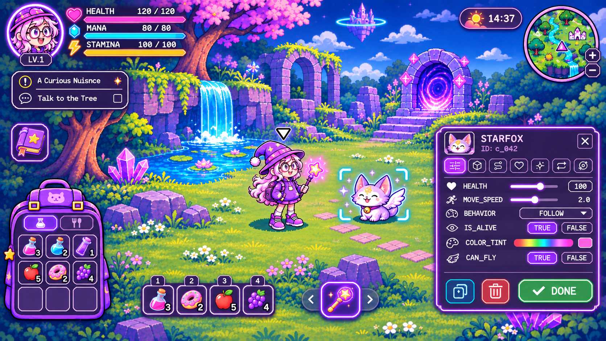

# Визуальные ориентиры

## Актуальный утверждённый HUD (21 ноября 2026)

**[Оригинальный PNG, утверждённый референс](hud/HUD_APPROVED_CURRENT_REFERENCE_2026-11-21.png)** · [Что именно закреплено и что иллюстративно](hud/README.md). Это визуальный ориентир для текущей композиции HUD, не готовая реализация Godot и не утверждение о географии локации.

## Главное меню

[Макет главного меню](menu/title-screen.jpg) — ориентир по композиции и визуальной иерархии. Логотип и кнопки слева, крупная Луна и живой мир справа. Работа над меню будет отдельным этапом.

## Концепты Этернии от 20 ноября

| Изображение | Зачем открывать |
| --- | --- |
| [Улица Люмы](concepts-2026-11-20/luma-street-and-ray.jpg) | Тёплые витрины, лавандовый город, зелень, влажная мостовая и уютный пассажирский купол на скате. |
| [Площадь Люмы](concepts-2026-11-20/luma-square-and-ray.jpg) | Читаемая посадочная площадка, оживлённая площадь, террасы и многослойность города. |
| [Глючные руины](concepts-2026-11-20/glitch-ruins.jpg) | Контраст обычного камня и лазурных каркасов, частично исчезающая геометрия. |
| [Белая Пустота](concepts-2026-11-20/white-void.jpg) | Белизна, светлый шум, лавандовые окна и дробящаяся геометрия. |
| [Парящие острова](concepts-2026-11-20/floating-islands.jpg) | Висящие арки, каскады, зелень на камне и ощущение высоты. Подписи о слоях Пустоты на арте исторические. |
| [Поляна с лисичкой](concepts-2026-11-20/meadow-starfox.jpg) | Сочная зелень, водопад, большие читаемые силуэты зверьков и предметов. |
| [Поляна со слаймом](concepts-2026-11-20/meadow-slime.jpg) | Сказочный уют, фонари, тропа, ручей и древесные укрытия. |
| [Поляна с клёном](concepts-2026-11-20/meadow-maple.jpg) | Контраст сиренево-розовой кроны и голубой воды, ступени и тёплый вечерний свет. |
| [Озорная магия](concepts-2026-11-20/meadow-playful-magic.jpg) | Ритм и юмор, оживший холодильник и пончик, лаконичные формы и акцентные эффекты. |

Эти изображения задают настроение, отдельные детали и цвет. Рабочий ракурс — [мануал §09.8](../docs/manual/00_LUNA_PRODUCTION_MANUAL.md); пиксельная сетка и слои — [гайд окружения](../docs/art/ENVIRONMENT_ART_DIRECTION_AND_PROMPTS_V1.md). HUD: визуальная основа из [пиксельного комплекта](../assets/approved/README.md), функции и состав из актуального мануала. Если конкретный оригинал референса не найден, не подменять его описанием или похожим изображением. Текст, цифры, вкладки интерфейса и топология на концептах не имеют статуса игровых решений.

[Авторские образцы](author/) · [Указатели ранних референсов](archive-indexes/)
