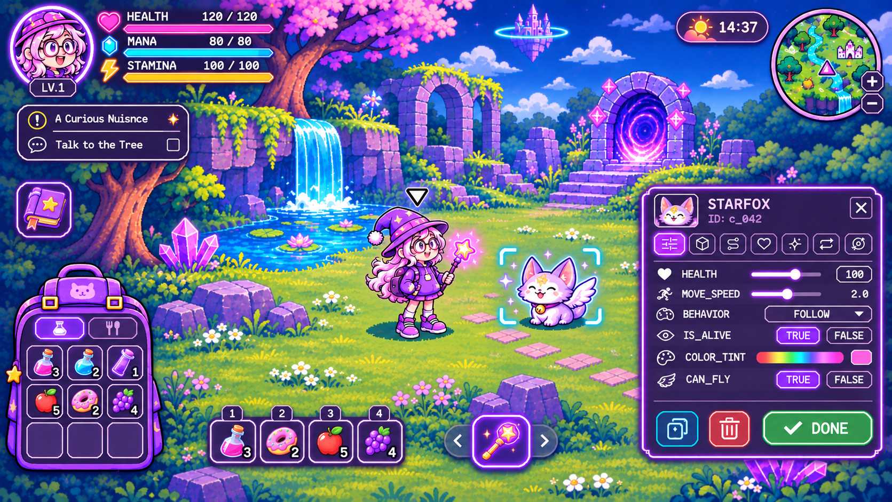

# Актуальный утверждённый HUD LUNA (21.11.2026)

**Файл:** `HUD_APPROVED_CURRENT_REFERENCE_2026-11-21.png`  
**Статус:** утверждённый автором визуальный референс актуальной композиции игрового HUD. Не готовые UI-ассеты и не фиксация географии или существ конкретного экрана.  
**Исходный размер:** 1671 × 941 px.  
**SHA-256 оригинального PNG:** `14c091ecac0e6b726d76ea5e695e2562d5b0878f118aeabe213d7956dfed13f0`.

## Смысл одобрения

- Компактный портрет Луны, шкалы HP/Mana/Stamina; слева список необязательных текущих историй, ниже отдельная большая иконка журнала без подписи.
- Инвентарь-рюкзак нормальных пропорций: «Инструменты» и «Зелья и еда», по 9 видимых слотов в каждой вкладке до взлома интерфейса. Дополнительные найденные вещи не исчезают; после взлома доступны расширение и прокрутка.
- Панель быстрого доступа к расходникам, которую можно переназначать и которая может заполняться автоматически. Рядом один крупный активный инструмент с малозаметными полупрозрачными стрелками переключения.
- Вверху справа миникарта, левее компактная иконка времени суток и часы без номера дня.
- Редактор взлома: компактная высокая прямоугольная панель в **правом нижнем углу**. Имена полей и системных параметров на английском (`HEALTH`, `MOVE_SPEED`, `BEHAVIOR`, `IS_ALIVE`, `COLOR_TINT`, `CAN_FLY`). Кнопки копирования и удаления только цветными пиктограммами; зелёная кнопка `DONE`. Отдельной `UNDO`-кнопки нет.
- Выбранная цель `STARFOX` соответствует существу на сцене. Выделение цели плоскими светящимися неоновыми уголками, не объёмным кубом.
- Постоянные подсказки по кнопкам отсутствуют: контекстные `E` и `TAB` показываются при освоении действий; имя хака в мире должно быть глючащим и нечитаемым. `V` для закрытия глаз остаётся секретом.
- На основном игровом HUD не писать `ACCESS LEVEL` или `PLAYFUL`/ `DEVELOPER`.

Тексты задач, параметры конкретной лисы, детальные изображения отдельных предметов, декоративные здания и топология местности **иллюстративны**. При реализации сверять референс с последними прямыми авторскими решениями и работающим набором пиксельного HUD в `assets/approved/hud/`.
